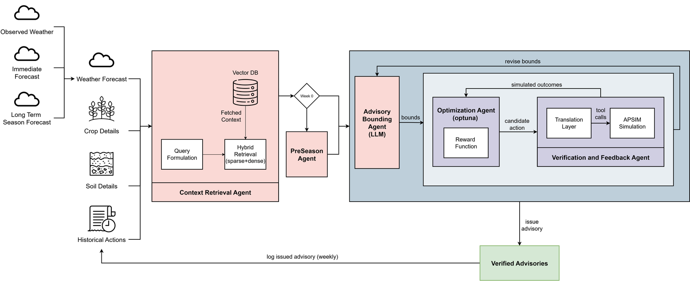
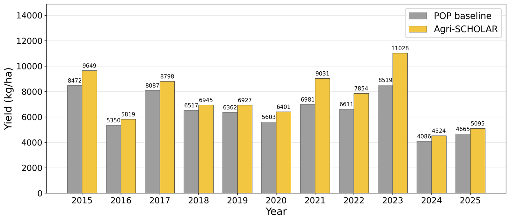

# Agri-SCHOLAR

This repository contains the code and results for the paper "Agri-SCHOLAR: Simulation-Grounded In-Season Rolling Advisories for Agricultural Crops Using LLM-Bounded Optimization" by Geetha Charan, Vedant Balasubramaniam, Manojkumar Patil, V. Priyanka, Rohit P. Suresh, Kodur Sai Vinay Sathvik, Mohammad Sufyan Azam and Y. Narahari, Game Theory Lab, IISc [(arXiv:2610.31003)](https://arxiv.org/abs/2610.31003). A PDF is in [`paper/`](paper/agri_scholar.pdf).

Agri-SCHOLAR issues a personalized crop advisory every week of the season. LLM agents propose agronomically sound bounds on the actions (urea and irrigation), an optimizer searches inside those bounds, and every candidate is checked in the APSIM NextGen crop simulator before it is issued. The agents only see weather that would be available on the decision day: observations to date, a degraded 7-day forecast, and an analog tail from the closest historical years.



## Results

Maize, 11 seasons (2015-2025) in an irrigated and a rainfed region of Karnataka, against the regional Package of Practices (PoP) run with perfect weather foresight:

| | Irrigated | Rainfed |
| --- | --- | --- |
| Mean yield gain over PoP | +15.2% | +22.4% |
| Mean net profit gain over PoP | +17.2% | +22.8% |
| Seasons where Agri-SCHOLAR beats PoP | 11 / 11 | 11 / 11 |



## Method

| Agent | Role |
| --- | --- |
| Context Retrieval Agent | weather narrative plus hybrid BM25 + dense retrieval over the Package-of-Practices corpus |
| Preseason Agent | land preparation and season structure: split and event caps, minimum doses, season totals |
| Advisory Bounding Agent | LLM (Gemma) proposes this week's urea and irrigation bounds |
| Optimization Agent | Optuna search inside the bounds with a risk-adjusted reward |
| Verification and Feedback Agent | runs each candidate in APSIM, scores it, and writes a critique back to the ABA |

```
pre-season:  sowing date -> PSA <-> OA/VFA reflection for land prep and season caps
every week:  CRA context -> [ABA bounds -> OA search -> VFA in APSIM -> critique] x N -> lock best action
end:         replay the issued plan in APSIM under the observed weather
```

The reward (Eqs. 2-14 of the paper) is revenue minus production cost minus sustainability penalties for waterlogging, nitrogen oversupply, deep drainage, nitrate leaching and soil carbon loss.

## Repository Structure

- **agri_scholar/config.py**: default settings, overridden by the experiment files.
- **agri_scholar/pipeline.py**: the season loop and the parallel runner.
- **agri_scholar/agents/**: the five agents, plus `fixed_bounds.py` for the no-LLM ablations.
- **agri_scholar/simulation/**: APSIM file editing and execution, action handling and caps, weather construction and forecast degradation, and the reward.
- **agri_scholar/llm.py**: the shared, seeded Gemma instance.
- **configs/**: one JSON file per experiment in the paper.
- **scripts/**: PoP and conventional baselines, the RAG corpus builder, tables and plots.
- **tests/**: checks that run without a GPU or APSIM.
- **apsimx/**: calibrated and PoP APSIM models.
- **data/weather_maize_pilot/**: daily weather (.met) per location and year.
- **results/**: outputs of the runs reported in the paper.
- **paper/**: the paper PDF.
- **run.py**: entry point.

## Setup

| Requirement | Notes |
| --- | --- |
| Python 3.10+, Linux | |
| NVIDIA GPU | Gemma-4-E4B in bf16 needs about 16 GB per parallel season |
| [APSIM NextGen](https://www.apsim.info/download-apsim/) | `Models` on `PATH`, or `APSIM_MODELS_EXE=/path/to/Models` |
| Hugging Face access to `google/gemma-4-E4B-it` | gated model: accept the licence, then `huggingface-cli login` |

```bash
git clone https://github.com/KSVinaySathvik/agri-scholar.git
cd agri-scholar
pip install -r requirements.txt
python -m pytest tests -q
```

## Running

```bash
python run.py --config configs/mandya.json --gpus 0 1
python run.py --config configs/haveri.json --years 2023 2024
```

| Experiment | Config | Results |
| --- | --- | --- |
| Main pipeline | `configs/main.json` | `results/main/` |
| Irrigated region (Mandya), 2015-2025 | `configs/mandya.json` | `results/mandya/` |
| Rainfed region (Haveri), 2015-2025 | `configs/haveri.json` | `results/haveri/` |
| Haveri reruns, sowing after monsoon onset | `configs/haveri_rerun.json` | `results/haveri_rerun/` |
| Ablation: no LLM, fixed wide bounds | `configs/ablation_fixed_bounds.json` | `results/ablation_fixed_bounds/` |
| Ablation: no LLM, PoP-derived bounds | `configs/ablation_pop_bounds.json` | `results/ablation_pop_bounds/` |

Each season runs in its own process and writes one JSON with the locked actions, weekly advisories, VFA critiques, final yield and reward breakdown. A season takes several hours, so use `tmux` or `nohup`. All settings and their defaults are in `agri_scholar/config.py`; the two that switch between experiments are `BOUNDS` (`llm`, `fixed`, `pop`) and `SOWING` (`pop_date`, `onset`, `window`).

Baselines and analysis (no GPU needed):

```bash
python -m scripts.pop_baseline --location Mandya --base-file apsimx/Maize_Mandya_pop2.apsimx --years 2015-2025 --weather observed
python -m scripts.make_ablation_tables
python -m scripts.plot_baseline_comparison
```

The RAG corpus (`rag_corpus.json`) and its embedding cache are included. To rebuild them, put the PoP PDFs in `Package_Of_Practices/`, run `python -m scripts.build_rag` and delete `rag_corpus_embeddings.npy`.

## Citation

```bibtex
@article{charan2026agrischolar,
  title   = {Agri-SCHOLAR: Simulation-Grounded In-Season Rolling Advisories for Agricultural Crops Using LLM-Bounded Optimization},
  author  = {Charan, Geetha and Balasubramaniam, Vedant and Patil, Manojkumar and Priyanka, V. and Suresh, Rohit P. and Sathvik, Kodur Sai Vinay and Azam, Mohammad Sufyan and Narahari, Y.},
  journal = {arXiv preprint arXiv:2610.31003},
  year    = {2026}
}
```
